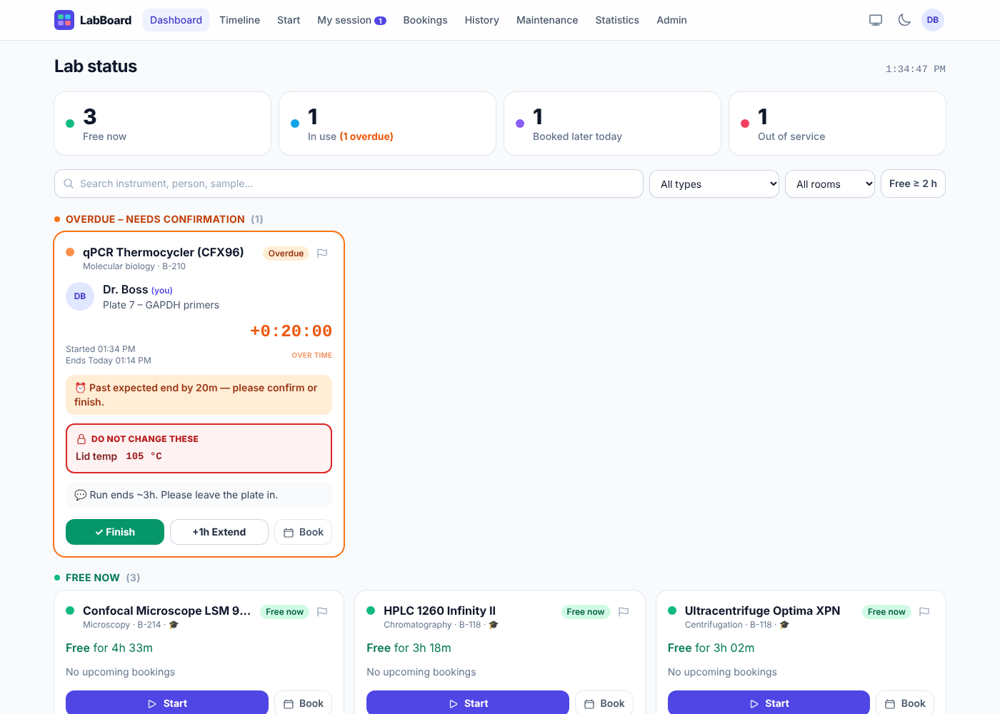
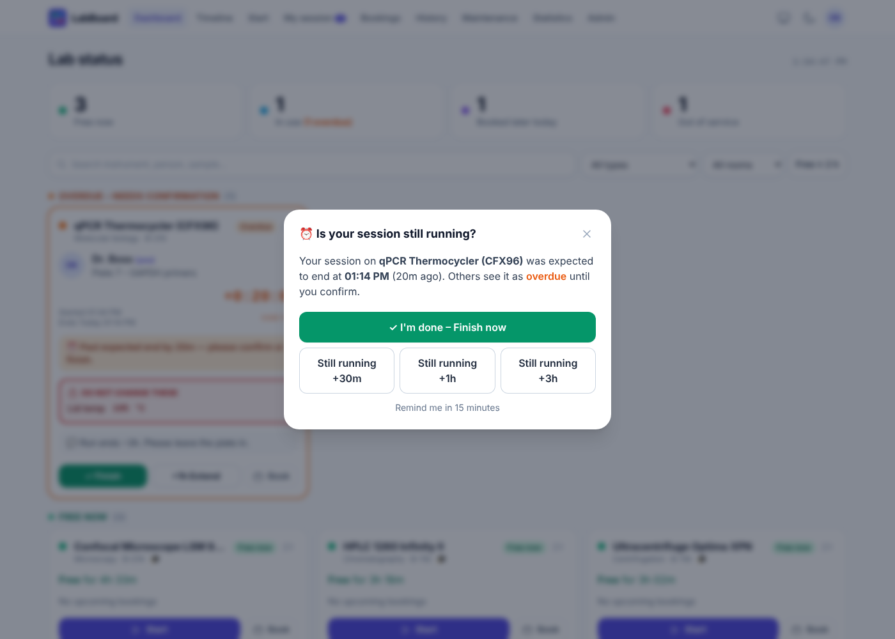
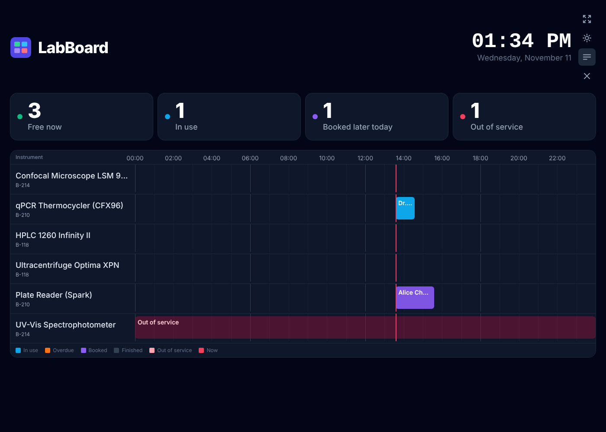
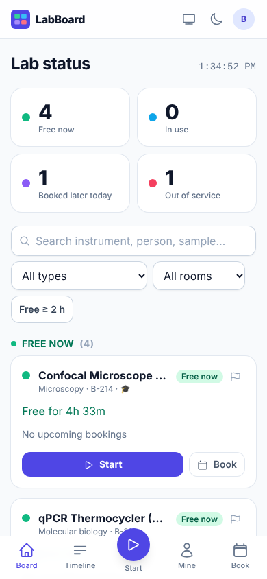

# LabBoard

A live board for a research lab's shared instruments. Anyone in the lab can see in a second what is free, who is using what, and which settings they must not touch. Starting a session takes about 20 seconds.

**Stack:** React 18 + Vite + Tailwind CSS · Firebase Authentication (Google) · Cloud Firestore (real-time listeners) · Firebase Hosting · installable PWA.
**Cost:** runs entirely on the free **Spark** plan. No Cloud Functions, no Cloud Storage, no paid extensions. [Spark-plan limits](#honest-limitations-spark-plan) explains what that rules out.

| Dashboard (overdue session) | “Still running?” prompt |
|---|---|
|  |  |
| **Big-screen mode (dark)** | **Phone** |
|  |  |

---

## Contents

1. [Features by version](#features-by-version)
2. [Project structure](#project-structure)
3. [Data model](#data-model-firestore-collections)
4. [Access control & security rules](#access-control--security-rules)
5. [Step-by-step Firebase setup](#step-by-step-firebase-setup)
6. [Deploy](#deploy)
7. [Local development with emulators (no Firebase project needed)](#local-development-with-the-emulators)
8. [Everyday use](#everyday-use)
9. [Honest limitations (Spark plan)](#honest-limitations-spark-plan)
10. [Customising](#customising)

---

## Features by version

All three versions are in this codebase. They are listed separately so you can roll them out to the lab in stages.

### Version 1: core board
- **Google sign-in with approval.** A user gets in if their email is on the approved list or belongs to your university domain. Everyone else waits on a “Waiting for approval” screen, which updates live as soon as an admin approves them.
- **Roles:** `admin`, `member`, `guest` (guests are read-only, e.g. a lab-monitor account).
- **Live dashboard.**
  - A **summary strip** shows Free now / In use (with overdue count) / Booked later today / Out of service. Tap a tile to filter.
  - The **instrument grid is grouped by status.**
    - *Free:* how long it has been free, and the next booking.
    - *In use:* user name and photo, sample/experiment, start time, a **live countdown** to the expected end, a bold red **“Do not change these”** box with the locked parameters, and the user's comments.
    - *Booked:* who reserved it and when. If the booking has started but nobody has begun a session, the card shows when it will be auto-released.
    - *Out of service:* the reason.
- **Start Session form, about 20 seconds:**
  - pick the instrument (busy, reserved, out-of-service and untrained instruments are greyed out with the reason)
  - set the expected end with quick buttons **+30m, +1h, +2h, +3h, +6h, +12h, Overnight (next 09:00)** or an exact time
  - optional sample name, locked parameters as key/value rows, and comments
  - it remembers the parameters you used last time on that instrument
- **My Session page:** one-tap **Finish**, quick **Extend** (+30m/+1h/+3h/+6h/+12h/exact), and in-place editing of comments and parameters.
- **Overdue handling:** when a session passes its end time, its card turns **orange** for everyone. The owner gets a pop-up on any page: *“Is your session still running?”* → Finish now / Still running +30m / +1h / +3h. The pop-up keeps coming back (snoozable for 15 min), so the board never stays wrong for long.

### Version 2: planning
- **Booking calendar** (week view per instrument). Tap a free slot, pick a length, done.
  - **Overlapping bookings are blocked**, both by a server re-check and by a race-condition guard (see limitations).
  - **Maximum booking length** per instrument, enforced in the security rules.
  - **Auto-release:** a booking nobody starts within **30 minutes** is released automatically.
- **Day timeline:** one row per instrument, coloured blocks across 24 h (in use / overdue / booked / finished / out of service), a “now” line, and day navigation.
- **Filters** by instrument type, room, and **“Free ≥ 2 h”**, plus a **search box** (instrument, person, sample).
- **History log:** searchable by instrument, person, date range and free text (sample, comments, parameters), with CSV export.
- **Saved parameter templates** per instrument. Apply one with a single tap on the Start form; save new ones with a checkbox.

### Version 3: management
- **Admin panel:**
  - add and edit instruments (photo URL, location, manual link, safety notes, required training, max booking length, restricted flag)
  - mark an instrument out of service or back in service
  - approve or revoke users and change roles
  - **training approvals** per restricted instrument
  - pre-approved email list (paste many at once)
  - force-finish stale sessions
  - load sample data
  - CSV exports
- **Instrument detail page:** photo, location, manual, safety notes, required training (and whether *you* are approved), live status, upcoming bookings, maintenance, open issues, recent sessions.
- **Issue reports:** a flag button on every card and detail page, with a severity level. Admins resolve issues, and critical issues come with a one-click “mark out of service”.
- **Maintenance & calibration schedule:** interval, last-serviced and next-due dates, overdue and due-soon highlighting, a “Serviced today” log button, and CSV export.
- **Usage statistics:** hours per instrument, per person and per month, plus idle capacity. Summary and raw CSV export.
- **Notifications** (in-app plus browser notifications while LabBoard is open):
  - 10 minutes before your session ends
  - when it becomes overdue, then every 30 min
  - 10 minutes before your booking starts
  - when your booking starts and the 30-minute release clock is running
- **Big-screen mode** (`/board`) for a lab monitor: huge type, live clock, alternates between cards and timeline every 30 s, full-screen button, keeps the screen awake (Wake Lock), dark-mode toggle.
- **Dark mode**, **mobile-first layout** with a bottom tab bar, and **installable PWA** (offline app shell, Firestore offline cache, app shortcuts).

---

## Project structure

```
.
├── firebase.json              Hosting (SPA rewrite, caching headers) + emulator config
├── firestore.rules            Security rules (the real access control)
├── firestore.indexes.json     One composite index (sessions by instrument + time)
├── .env.example               Firebase web config template → copy to .env.local
├── .firebaserc.example        Project alias template → copy to .firebaserc
├── index.html                 App shell, theme pre-paint, manifest link
├── public/
│   ├── manifest.webmanifest   PWA manifest (icons, shortcuts)
│   ├── sw.js                  Service worker (offline shell, notification clicks)
│   └── icons/                 SVG + PNG (192, 512, maskable) icons
├── seed/seed-data.json        Sample instruments / maintenance / templates (reference copy)
├── tests/rules.test.mjs       28 security-rule tests (run against the emulator)
├── docs/screenshots/          Screenshots used in this README
└── src/
    ├── main.jsx               Providers + service-worker registration
    ├── App.jsx                Routing, approval gate, role guards, code-splitting
    ├── index.css              Tailwind entry
    ├── lib/
    │   ├── firebase.js        Firebase init, offline cache, emulator switch
    │   ├── data.js            ALL Firestore writes (sessions, bookings, admin, …)
    │   ├── status.js          Card status derivation, auto-release logic
    │   ├── time.js            Formatting, countdowns, quick-time helpers
    │   ├── csv.js             CSV export
    │   ├── seed.js            “Load sample data” (admin button)
    │   └── seedData.js        Sample instruments, maintenance, templates
    ├── contexts/
    │   ├── AuthContext.jsx    Google sign-in, profile creation, live profile
    │   ├── DataContext.jsx    App-wide real-time listeners + no-show release
    │   ├── ThemeContext.jsx   Dark mode
    │   └── ToastContext.jsx   Toasts + friendly error messages
    ├── hooks/
    │   ├── useQuery.js        Generic live Firestore query
    │   ├── useSessionsRange.js One-shot range query (history / stats)
    │   ├── useNow.js          Ticking clock
    │   ├── useReminders.js    In-app / browser notifications
    │   └── useSessionActions.js Finish / extend with booking-conflict check
    ├── components/
    │   ├── ui.jsx             Buttons, inputs, modal, tabs, icons…
    │   ├── Layout.jsx         Top nav, mobile tab bar, account menu
    │   ├── InstrumentCard.jsx The status card (normal + big-screen)
    │   ├── LockedParams.jsx   Red “Do not change these” box
    │   ├── ParamEditor.jsx    Key/value rows
    │   ├── EndTimePicker.jsx  +1h / +3h / +12h / Overnight buttons
    │   ├── DayTimeline.jsx    Timeline rows
    │   ├── SummaryStrip.jsx, FilterBar.jsx, IssueButton.jsx
    │   ├── OverdueGuard.jsx   “Is your session still running?” prompt
    │   └── InstallPrompt.jsx  “Install LabBoard” chip
    └── pages/
        Login, Pending, Dashboard, StartSession, MySession, Timeline,
        Bookings, History, InstrumentDetail, Maintenance, Stats, Admin, BigScreen
```

---

## Data model (Firestore collections)

The seven requested collections, plus one small helper (`allowlist`) for pre-approved emails.

| Collection | Doc ID | Key fields |
|---|---|---|
| `users` | Firebase Auth uid | `email`, `name`, `photoURL`, `role` (`admin`/`member`/`guest`), `approved`, `trainedOn: [instrumentId]`, `notify` |
| `instruments` | auto | `name`, `type`, `room`, `location`, `photoURL`, `manualURL`, `safetyNotes`, `requiredTraining`, `restricted`, `maxBookingHours`, `status` (`ok`/`out_of_service`), `outOfServiceReason`, `activeSession: {sessionId, uid} \| null`, `freeSince` |
| `sessions` | auto | `instrumentId`, `instrumentName`, `userId`, `userName`, `userPhoto`, `sample`, `params: [{key,value}]`, `comments`, `startedAt`, `expectedEnd`, `endedAt`, `status` (`active`/`finished`), `bookingId`, `extendedCount` |
| `bookings` | auto | `instrumentId`, `userId`, `userName`, `start`, `end`, `purpose`, `status` (`booked`/`started`/`cancelled`/`released`), `sessionId` |
| `templates` | auto | `instrumentId`, `name`, `params`, `createdBy` |
| `issues` | auto | `instrumentId`, `reportedBy`, `description`, `severity`, `status` (`open`/`resolved`), `resolvedBy`, `resolution` |
| `maintenance` | auto | `instrumentId`, `kind` (`maintenance`/`calibration`), `title`, `intervalDays`, `lastServiced`, `nextDue`, `log[]` |
| `allowlist` | lower-case email | `role` |

`instruments.activeSession` is a small lock. A session is started in a **transaction** that creates the session and claims the instrument together, so two people can never start on the same instrument at once. The rules verify the lock points at a real session owned by the caller (`getAfter`).

---

## Access control & security rules

All access control lives in [`firestore.rules`](firestore.rules). The UI only hides buttons; the rules are what actually protect the data.

| Action | Who |
|---|---|
| Read anything | approved users (any role) |
| Create own profile | anyone signed in, but `role`/`approved` must match the allowlist entry or the university domain; otherwise stored as **pending guest** |
| Change roles, approve, grant training | **admins only** (users cannot edit their own role, approval or `trainedOn`) |
| Add / edit / delete instruments, mark out of service | **admins only** |
| Start a session | members/admins, for themselves only, instrument in service, **training approval required for restricted instruments** |
| Edit / extend / finish a session | **only the session owner** (admins may force-finish) |
| Create a booking | members/admins, for themselves only, in the future, ≤ `maxBookingHours`, training approval for restricted instruments |
| Cancel / move a booking | owner (or admin) |
| Release a no-show booking | any approved user, **only** once 30 min have passed since its start (checked with `request.time`) |
| Templates | anyone can read; creator (or admin) edits/deletes |
| Report issue | any approved user (guests too); admins resolve |
| Maintenance | admins write; everyone reads |
| Allowlist | admins only |

**Tests:** `tests/rules.test.mjs` contains 28 tests covering every row above. They pass against the Firestore emulator:

```bash
npm run test:rules
```

(Needs the Firebase CLI and Java 11+, see below.)

---

## Step-by-step Firebase setup

You need **Node.js 18+** and a Google account. Everything below is free.

### 1. Create the Firebase project
1. Go to <https://console.firebase.google.com> → **Add project**.
2. Pick a name (e.g. `labboard-mylab`). Google Analytics is optional; you can turn it off.
3. Stay on the **Spark (no-cost)** plan. Do **not** add billing.

### 2. Register the web app
1. In the project overview, click the **Web** icon (`</>`).
2. App nickname: `LabBoard`. You can tick “Also set up Firebase Hosting”.
3. Copy the `firebaseConfig` values it shows.

### 3. Enable Google sign-in
1. **Build → Authentication → Get started**.
2. **Sign-in method → Google → Enable**, choose a support email, **Save**.
3. **Settings → Authorized domains:** `localhost` and `<project>.web.app` / `<project>.firebaseapp.com` are already there. Add your own domain if you use one later.

### 4. Create Cloud Firestore
1. **Build → Firestore Database → Create database**.
2. Choose a location close to your lab (e.g. `europe-west3`, `us-central1`). **This cannot be changed later.**
3. Start in **production mode** (the real rules get deployed in step 7).

### 5. Configure the app
```bash
git clone <this repo> labboard && cd labboard
npm install
cp .env.example .env.local
```
Fill `.env.local` with the values from step 2:
```
VITE_FIREBASE_API_KEY=AIza...
VITE_FIREBASE_AUTH_DOMAIN=labboard-mylab.firebaseapp.com
VITE_FIREBASE_PROJECT_ID=labboard-mylab
VITE_FIREBASE_STORAGE_BUCKET=labboard-mylab.appspot.com
VITE_FIREBASE_MESSAGING_SENDER_ID=123456789
VITE_FIREBASE_APP_ID=1:123456789:web:abc123
VITE_ALLOWED_DOMAIN=myuniversity.edu
```
> The Firebase web config is not secret. It identifies the project, and the security rules protect the data.

### 6. Set your university domain in the rules
Open `firestore.rules` and edit:
```js
function allowedDomainRegex() {
  return '.*@university[.]edu$';      // ← e.g. '.*@myuniversity[.]edu$'
}
```
Write a dot as `[.]`. To allow two domains: `'.*@(uni-a[.]edu|uni-b[.]ac[.]uk)$'`. If you **do not** want domain auto-approval (only the explicit list), use `'^$'`.

### 7. Install the Firebase CLI and deploy the rules
```bash
npm install -g firebase-tools
firebase login
cp .firebaserc.example .firebaserc     # then put your project ID in it
npm run deploy:rules                   # rules + index
```

### 8. Make yourself the first admin
Before your first sign-in, create one document by hand:
1. Console → **Firestore Database → Start collection** → Collection ID: `allowlist`.
2. Document ID: **your Google email in lower case**, e.g. `jane.doe@gmail.com`.
3. Add a field: `role` (string) = `admin` → **Save**.

Sign in and you'll be an admin. From then on, manage everyone from **Admin → Approved list / Users & training**.

> Already signed in before doing this? Sign out and back in. The app picks up the allowlist entry and upgrades your profile.

### 9. Run it locally
```bash
npm run dev            # http://localhost:5173
```
Sign in, open **Admin → Data → Load sample data** to get six example instruments (one out of service), maintenance items and parameter templates.

---

## Deploy

```bash
npm run deploy         # builds and deploys hosting + rules + indexes
```
Your app is live at `https://<project-id>.web.app`. Open it on a phone and use **“Add to Home Screen”** / **Install** to get the app icon. For the lab monitor, open `https://<project-id>.web.app/board` and press the full-screen button.

**Lab-monitor tip:** create a separate Google account for the monitor, add it to the allowlist as **guest** (view only), sign in once on the monitor's browser, and leave `/board` open.

To update later: `git pull && npm install && npm run deploy`.

---

## Local development with the emulators

Try everything without a Firebase project, or before touching real data:

```bash
npm install -g firebase-tools    # needs Java 11+ for the Firestore emulator
npm run emulators                # terminal 1: Auth + Firestore + Emulator UI (http://127.0.0.1:4000)
npm run dev:emu                  # terminal 2: app at http://localhost:5173
```
The login page then shows an **“Emulator sign-in”** box where you can type any email. To become admin, create `allowlist/<your-email>` with `role: "admin"` in the Emulator UI first, or sign in as `someone@university.edu` to be a member.

```bash
npm run test:rules               # 28 security-rule tests
```

---

## Everyday use

| I want to… | Do this |
|---|---|
| See what's free | Open the app: green cards, or tap **Free now** in the summary strip. Use **Free ≥ 2 h** for long runs. |
| Start using an instrument | **Start** (or **Start** on a card) → pick end time (+1h, +3h, Overnight…) → optionally sample, locked parameters, comment → **Start session**. |
| Protect my settings | Add them as **locked parameters**. They appear in a red “Do not change these” box on the card. |
| Re-use settings | Your last parameters are pre-filled; or tap a **template** chip; or tick “Save as template”. |
| I'm done | **Finish** on the card or on **My session**. One tap. |
| I need longer | **+1h Extend** on the card, or +30m/+1h/+3h/… on **My session**. |
| Reserve for later | **Bookings** → pick instrument → tap a slot → choose length → **Book**. Start the session within 30 min of the start or it's released. |
| Something's broken | Flag icon on the card → describe → **Send report**. |
| Find who ran what | **History** → filter by instrument / person / dates / text → **Export CSV**. |

---

## Honest limitations (Spark plan)

Spark is generous for a single lab, but it has **no Cloud Functions** (no server code) and, for projects created since Oct 2024, **no Cloud Storage bucket**. Here is what that means in practice:

| Area | What LabBoard does on Spark | What would need Blaze (or another service) |
|---|---|---|
| **Email / SMS notifications** | ❌ Not possible on Spark. LabBoard shows **in-app toasts and browser notifications only while LabBoard is open** (a tab, or the installed PWA running in the background on desktop/Android). | Email needs a server: Cloud Functions + the *Trigger Email* extension, or SendGrid/Mailgun, **all of which require Blaze**. True background push (FCM sent when the app is closed) also needs a server to send it. |
| **Auto-release of no-show bookings** | Done **client-side**: any open LabBoard (the lab monitor counts) releases bookings 30 min after their start. The rules enforce that nobody can release a booking earlier. If **no** LabBoard is open anywhere, the booking simply *looks* expired (the UI already treats it as released) and is cleaned up the next time someone opens the app. | A scheduled Cloud Function (Blaze) could do it on the server. |
| **Booking overlap prevention** | Firestore rules can't query other documents, so overlap is checked on the client against fresh server data. Then a **race guard** re-reads after writing: if two people booked the same slot within milliseconds, the later one is deleted and told. Max length, future-only, training and ownership **are** enforced by the rules. | A Cloud Function or per-slot lock documents could make it fully server-enforced. |
| **Overdue sessions** | The card turns orange and the owner is prompted whenever they have LabBoard open. Nothing finishes a session automatically, by design: only the owner (or an admin, via **Admin → Active sessions → Force finish**) may end it. | Auto-finishing or emailing the owner would need a server. |
| **Instrument photos** | Paste an **image URL** (e.g. from your lab website, Google Drive public link, Imgur). | Uploading files needs Cloud Storage, which needs Blaze on new projects. |
| **Quotas** | Spark gives **50 000 reads, 20 000 writes, 1 GiB storage per day** for Firestore and **10 GB/month** hosting transfer. A lab of ~30 people with ~20 instruments uses a small fraction of this. Listeners are scoped (only active sessions, recent bookings), history/stats use one-shot queries, and Firestore's offline cache cuts repeat reads. | If you outgrow it (hundreds of users, many always-on monitors), Blaze is pay-as-you-go and has the same free tier included. |
| **Time zones** | All times are shown in each browser's local time zone. For a single-site lab that's correct. | — |
| **Clock skew** | Countdown/overdue use the device clock. Release timing is validated by the server clock in the rules. | — |

Everything else in the feature list works fully on Spark.

---

## Customising

- **Quick end-time buttons:** `src/components/EndTimePicker.jsx` (`QUICK` array; “Overnight” = next 09:00 via `nextMorning()` in `src/lib/time.js`).
- **Auto-release grace period:** `AUTO_RELEASE_MIN` in `src/lib/status.js` **and** `duration.value(30, 'm')` in `firestore.rules`. Change both.
- **Default max booking length:** `DEFAULT_MAX_BOOKING_HOURS` in `src/lib/status.js` and the `12` default in `validBookingTimes()` in the rules. Per-instrument values are set in Admin.
- **Big-screen rotation:** `ROTATE_MS` in `src/pages/BigScreen.jsx`.
- **Colours / status labels:** `STATUS` in `src/lib/status.js`.
- **Branding:** `public/icons/icon.svg` (re-export the PNGs), `public/manifest.webmanifest`, theme colour in `index.html`.
